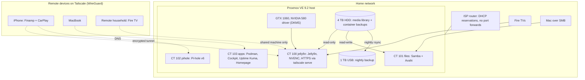

# Homelab: Self-Hosted Media and Services on Proxmox

A repurposed desktop turned into a Proxmox VE hypervisor that runs isolated
Linux containers for media streaming, file sharing, network-wide ad blocking,
and a Podman container host for monitoring and a dashboard. Everything is
reachable remotely through Tailscale (WireGuard) **with zero ports open on the
home router**, and the irreplaceable data is backed up automatically every
night.

Built from bare metal in October 2026 as a hands-on companion to my
cybersecurity coursework.

> All IP addresses, hostnames, tailnet names, and credentials in this
> repository are placeholders.

## Highlights

- **Hypervisor:** Proxmox VE 9.2 on a single host, with every service in its
  own **unprivileged** LXC container.
- **Media streaming:** Jellyfin with **NVIDIA NVENC hardware transcoding**
  (GTX 1060 shared into an LXC container), verified in FFmpeg logs.
- **Remote access without port forwarding:** Tailscale mesh VPN, per-machine
  sharing for a remote family household, and **HTTPS with a real certificate**
  via `tailscale serve`.
- **Least privilege throughout:** read-only media mount for the streaming
  server, a read-only (PVEAuditor) API token for the dashboard, secrets kept
  in a `chmod 600` env file, no container-engine socket exposed.
- **Backups:** nightly systemd-timer job to an external drive (never deletes
  from the backup), a guard against writing to an unmounted target, and weekly
  Proxmox container snapshots copied off the main disk.
- **Monitoring:** Uptime Kuma checks every service each minute, including a
  separate check of the remote-access path; a Homepage dashboard pulls live
  stats from each service.
- **Documented troubleshooting:** a dozen-plus real incidents, from a layer-1
  network outage to container DNS and systemd exec failures, written up in
  [docs/troubleshooting.md](docs/troubleshooting.md).

## Architecture



| ID | Container | Role |
|---|---|---|
| host | `pve` | Proxmox VE, NVIDIA driver, backup timer, storage |
| 100 | `jellyfin` | Media server with GPU transcoding, Tailscale, HTTPS |
| 101 | `files` | Samba share so the library appears in macOS Finder |
| 102 | `pihole` | DNS ad/tracker blocking for my own devices via Tailscale DNS |
| 103 | `apps` | Podman host: Cockpit, Uptime Kuma, Homepage |

More detail: [docs/architecture.md](docs/architecture.md)

## Skills demonstrated

- Linux system administration (Debian), shell scripting, systemd services and timers
- Virtualization and containers: Proxmox VE, LXC (unprivileged, bind mounts, device passthrough), Podman and Compose
- Networking: DHCP reservations, DNS, NAT traversal, WireGuard/Tailscale, SMB
- Storage and backup design: ext4, fstab, rsync, snapshot backups, restore planning
- GPU driver management (NVIDIA + DKMS) and hardware video transcoding
- Security: least privilege, attack surface reduction, secret handling, threat modeling
- Methodical troubleshooting from the physical layer up

## Repository layout

```
README.md                 this overview
docs/
  architecture.md         hardware, storage, containers, data flows
  build-log.md            what was built, in order, and why
  security.md             security decisions, threat model, known gaps
  troubleshooting.md      incident write-ups (symptom, cause, fix, lesson)
  runbook.md              day-to-day operations and recovery
  roadmap.md              what's next
configs/
  host/                   fstab entry, backup script, systemd units, GPU setup
  lxc/                    relevant lines from each container's config
  files/                  Samba share configuration
  apps/                   Podman compose files, Homepage config (placeholders)
```
